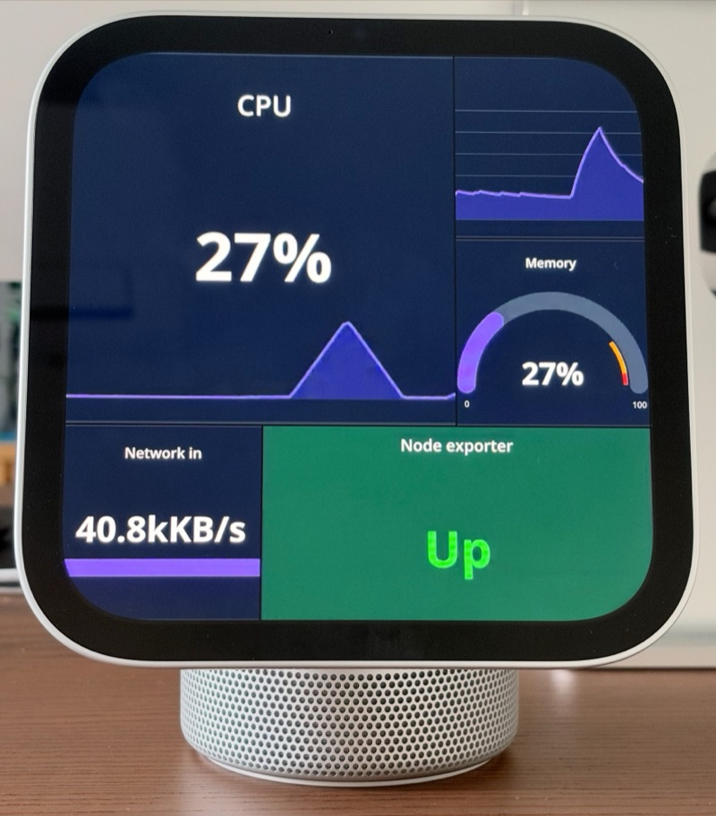

# homestat

Put your homelab numbers in the Apple Home app.

homestat reads values from **Home Assistant**, **Prometheus** and **MQTT**,
draws each one as a small dashboard tile (a stat with a sparkline, a gauge, a
bar, a graph or a status word) and shows it as a **camera** in Apple Home. Your
tiles then appear on your iPhone, iPad, Mac and Apple TV next to the rest of
your home.

<p align="center">
  
</p>

* One pairing for all tiles. New widgets appear in Home without pairing again.
* A single binary with no ffmpeg or Homebridge needed.
* Configure everything in a web UI with live previews.

## Quick start

You need a Linux machine on the same network as your Apple devices (host
networking is required, so Docker Desktop on macOS or Windows won't work), or
a Home Assistant OS install.

### Option 1: Home Assistant add-on

1. In Home Assistant go to **Settings → Add-ons → Add-on store → ⋮ →
   Repositories** and add `https://github.com/nathan-jones/homestat`.
2. Install **Homestat**, start it, and open **Homestat** in the sidebar.

The add-on connects to Home Assistant by itself and finds the Mosquitto
broker add-on if you have it. More in [addon/DOCS.md](addon/DOCS.md).

### Option 2: Docker

```sh
mkdir homestat && cd homestat
curl -O https://raw.githubusercontent.com/nathan-jones/homestat/main/docker-compose.yml
curl -o .env https://raw.githubusercontent.com/nathan-jones/homestat/main/.env.example
# edit .env and fill in the sources you use, then:
docker compose up -d
```

Or as a one-liner:

```sh
docker run -d --name homestat --network host -v ./data:/data \
  -e HOMESTAT_HA_URL=http://homeassistant.local:8123 \
  -e HOMESTAT_HA_TOKEN=your-long-lived-token \
  ghcr.io/nathan-jones/homestat
```

### Option 3: From source

Needs Rust 1.85 or newer, plus `cmake` and `nasm` (to build the H.264 encoder).

```sh
cargo run --release -- --ha-url http://homeassistant.local:8123 --ha-token your-long-lived-token
```

## Pair with Apple Home

1. Open the web UI at `http://<host>:8080` (or the sidebar panel in Home Assistant).
2. In the Home app tap **+ → Add Accessory** and scan the QR code shown in the
   web UI, or enter the setup code.
3. Tap **Add Anyway** when Home warns that the accessory isn't certified.
4. Back in the web UI, click **Add widget**. A few seconds later the new
   camera appears in Home.

The pairing keys and widgets live in the data directory (`./data`, or
`/data` in Docker). Back it up. If you lose it you'll need to remove the
bridge from Home and pair again.

## Data sources

Set sources with environment variables (below) or in the web UI by clicking
a source's name at the top of the page. **Test** checks the settings and
**Save** applies them straight away, no restart needed.

| Source | What a widget reads |
| --- | --- |
| Home Assistant | Any entity with a numeric state or attribute. `on`/`off`, `open`/`closed` and `home`/`not_home` become 1/0. |
| Prometheus | A PromQL query that returns one series (wrap others in `sum()`, `max()`, ...). Works with VictoriaMetrics, Thanos and Mimir too. |
| MQTT | A topic (wildcards allowed) with a number, or JSON picked with a path like `temperature` or `values.0`. |
| System | CPU, memory, load or process count of the machine homestat runs on. |
| Push | Values you POST to the API. |
| Demo | A random walk, for trying things out. |

Home Assistant and Prometheus widgets start with their recent history filled
in. If a source fails, the widget keeps its last value and shows the error on
the tile itself.

Want something to point it at? [examples/prometheus](examples/prometheus/README.md)
starts a local Prometheus and adds one widget of each type.

## Widget types

| Type | Shows |
| --- | --- |
| Stat | Title, big value and sparkline |
| Gauge | Semicircular dial (set `min` and `max`, default 0–100) |
| Bar | Value over a progress bar (`min`/`max`, default 0–100) |
| Graph | Chart with axis and gridlines, auto-scaled by default |
| State | A word for the current value, such as *Open* or *Closed*, in its own colour |

Each widget can also have its own colours (with preset themes) and
**thresholds** that recolour it when the value crosses a level, for example
amber at 80 and red at 95. All of this is in the widget dialog.

## Configuration

Every option is a flag or an environment variable (`homestat --help`).

| Env | Default | |
| --- | --- | --- |
| `HOMESTAT_NAME` | Homestat | Bridge name in Home |
| `HOMESTAT_HA_URL`, `HOMESTAT_HA_TOKEN` | | Home Assistant URL and [long-lived access token](https://www.home-assistant.io/docs/authentication/#your-account-profile) |
| `HOMESTAT_PROMETHEUS_URL` | | Prometheus HTTP API |
| `HOMESTAT_MQTT_URL` | | `mqtt://[user[:pass]@]host[:port]` |
| `HOMESTAT_PORT` | 51826 | HomeKit port. Change it if Homebridge already uses 51826. |
| `HOMESTAT_API_PORT` | 8080 | Web UI and API port |
| `HOMESTAT_API_ALLOW` | everyone | Comma-separated IPs allowed to use the web UI and API |
| `HOMESTAT_DATA_DIR` | `./data` (`/data` in Docker) | Pairing keys and widgets |
| `HOMESTAT_SETUP_CODE` | random | HomeKit setup code, `123-45-678`, used on first run only |
| `HOMESTAT_SAMPLE_INTERVAL` | 5 | Seconds between samples. Sparklines show the last 120. |

Sources set by an environment variable take priority and appear read-only in
the web UI.

## API

Everything the web UI does is available over HTTP:

```sh
# list widgets with their current values
curl localhost:8080/api/widgets

# add a widget
curl -X POST localhost:8080/api/widgets -H 'content-type: application/json' -d '{
  "name": "Solar", "unit": "kW",
  "source": {"type": "homeassistant", "entity_id": "sensor.solar_power"}}'

# a state widget with labels and colours
curl -X POST localhost:8080/api/widgets -H 'content-type: application/json' -d '{
  "name": "Garage door", "style": "state",
  "source": {"type": "homeassistant", "entity_id": "binary_sensor.garage_door"},
  "states": [{"value": 0, "label": "Closed", "color": "#34c759"},
             {"value": 1, "label": "Open",   "color": "#ff453a"}]}'

# push a value to a widget with "source": {"type": "push"}
curl -X POST localhost:8080/api/widgets/solar/value -H 'content-type: application/json' -d '{"value": 3.4}'

# edit (PUT the full widget), preview, delete
curl -X PUT localhost:8080/api/widgets/solar -H 'content-type: application/json' -d '{...}'
curl -o solar.png 'localhost:8080/api/widgets/solar/preview.png?width=1280&height=720'
curl -X DELETE localhost:8080/api/widgets/solar
```

<details>
<summary>Widget fields</summary>

| Field | |
| --- | --- |
| `name`, `unit`, `decimals` | Label, unit suffix and decimal places |
| `style` | `stat` (default), `gauge`, `bar`, `graph` or `state` |
| `source` | `{"type": "homeassistant", "entity_id": "...", "attribute": "..."?}`, `{"type": "prometheus", "query": "..."}`, `{"type": "mqtt", "topic": "...", "json_path": "..."?}`, `{"type": "system", "metric": "cpu" \| "memory" \| "load" \| "processes"}`, `{"type": "push"}` or `{"type": "demo"}` |
| `min`, `max` | Scale for gauge, bar and graph |
| `states` | For `state`: `[{"value": 0, "label": "Closed", "color": "#34c759"}, ...]`. Without it, 0/1 show as Off/On. |
| `colors` | `{"background", "text", "line", "fill"}` as `#rrggbb` |
| `thresholds` | `[{"from": 80, "color": "#ff9f0a"}, {"from": 95, "color": "#ff453a"}]` |

</details>

## Security

The web UI and API have **no login**. Anyone who can reach port 8080 can
change widgets and source settings. Keep it on a trusted network or limit it
with `HOMESTAT_API_ALLOW`. The Home Assistant add-on is only reachable through
Home Assistant's own login by default.

Saved tokens and passwords are stored in `<data dir>/providers.json`,
readable only by its owner, and the UI never shows them again.

## Limitations

* HomeKit allows up to 150 accessories per bridge, so up to 149 widgets.
* No MQTT over TLS yet.
* Home Assistant is polled every sample interval rather than subscribed to.
* Stat sparklines start at zero, which flattens values like temperatures. Use
  the graph type for those.

## Troubleshooting

* **The bridge doesn't show up in Home.** Make sure homestat uses host
  networking and runs on the same network (and VLAN) as your Apple devices,
  since discovery uses mDNS.
* **Camera shows "No response".** Run with `RUST_LOG=homestat=debug` and
  watch the `stream stats` lines for send errors.
* **Pair from scratch.** Click **Reset pairing…** in the web UI (your widgets
  are kept), remove the old bridge in Home under **Home Settings → Hubs &
  Bridges**, then add it again.

## Development

```sh
cargo test
```

`tools/e2e_check.py` acts as a HomeKit controller and checks a running server
end to end against independent implementations (aiohomekit, libsrtp, ffmpeg).
Its docstring has setup instructions.

| Path | What |
| --- | --- |
| `src/hap/` | HomeKit Accessory Protocol: pairing (SRP), encrypted sessions, accessory database, mDNS |
| `src/camera/` | Stream setup, RTP H.264 packetizing, SRTP |
| `src/widgets/` | Widget model, sources and renderers (`render/`, one module per type) |
| `src/api.rs`, `src/ui.html` | Web UI and API |
| `addon/` | Home Assistant add-on |

CI runs the tests and publishes a multi-arch (amd64/arm64) image to
`ghcr.io/nathan-jones/homestat`: `:edge` from `main`, and `:<version>` plus
`:latest` from `v*` tags.

## License

[MIT](LICENSE). Includes Open Sans, under the SIL Open Font License
([assets/fonts/OFL.txt](assets/fonts/OFL.txt)).
